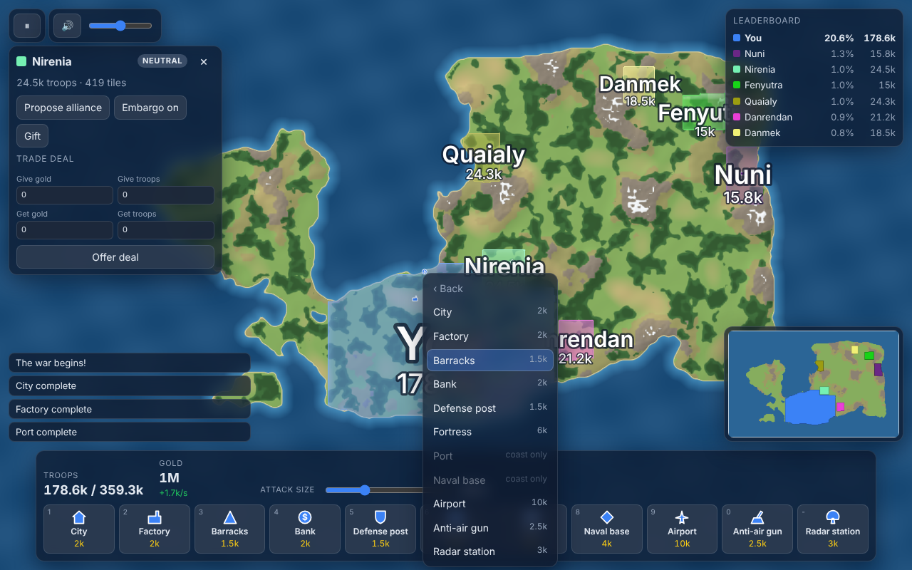

# Borderline

A browser strategy game in the spirit of Roblox's "take over the world" games (RoWorld / OpenFront): start from a
single spot on the world map, a random one, or The Box, grow your territory, build an economy and an army, and take
the map from up to 40 computer opponents and the small neutral tribes scattered between them.

**Play:** https://oofguy3.github.io/game/

The map is drawn by the graphics chip (WebGL2): natural land with forests, deserts, snow and shaded mountains, water
that moves, nations laid over the land like tinted glass, glowing borders, a shimmer on land just captured, and pulsing
front lines between nations at war. Computers without WebGL2, or whose browser only emulates the graphics chip (a
blocked driver, a virtual machine), get the plain flat look, which stays smooth there. `?look=flat` forces the flat
look, and `?look=gl` forces the graphics chip even when it is emulated (the browser tests use it). The old look is kept
for comparison in `docs/screenshots/*-before.png`.

## How to play

**Goal:** hold 80% of the land that is not radioactive fallout, be the last nation standing, or end the game allied
with everyone left. Losing shows **YOUR NATION HAS FALLEN**.

1. Pick a map, a mode, how many bots and how good they are (Easy, Normal, Hard, Insane).
   - **World** — real country names, plus many small neutral tribes (Storm Bison, Clawwatch, and the rest) to take early.
   - **Random** — a generated map, with invented nation names and fewer tribes.
   - **The Box** — the same sizes, all land and no water.
   - **Free-for-all** — everyone for themselves. **Vs Nations** — the computer nations start allied with each other;
     you and the tribes stay outside that alliance.
2. The banner says **CHOOSE YOUR STARTING LOCATION**. Tap any unclaimed land to place your capital. A countdown runs,
   then **THE WAR BEGINS**. For the first 60 seconds a nation that has not attacked another nation is protected.
   Farming empty land or a tribe does not end that protection; attacking a nation does. Mountains cost more troops
   to take than plains.
3. Click next to your land to expand into it or attack its owner. The attack-size slider sets how many of your troops
   go. Troops grow back over time, fastest when you hold about half of your maximum. The Attacks panel (top left)
   lists every front; **YOU ARE UNDER ATTACK** appears there and as a banner when one of them is yours.
4. Spend gold on buildings, ships and planes. Each extra building of the same kind costs as many times the base price
   as you will own (the second is double, the third triple). Right-click, or press and hold on a phone, for
   everything you can do there.
5. Reaching the sea shows **You reached the sea. Click a distant coast to send a boat invasion.** Troop boats draw a
   dotted line along their route.
6. A Missile Silo unlocks the atom bomb, the hydrogen bomb and the MIRV (three warheads). They leave green fallout,
   which still belongs to whoever holds it but does not count toward the 80% win. Right-click your own fallout to
   decontaminate it, a few tiles at a time, for gold. A SAM launcher shoots down one incoming warhead per moment.
   The computer nations do not build silos or launch nukes.
7. Make alliances, peace and trade deals. Breaking an alliance marks you **TRAITOR** for 30 seconds, on the map and
   the leaderboard, and attacks on you cost only half as many troops.

### Controls

| Input | What it does |
|---|---|
| Left click | Expand or attack there (by boat if it is across the water); during the start, choose your spot |
| Right click, or press and hold | Menu: attack, send a boat, bomb, paratroopers, build, nuke, decontaminate, build a warship or fighter, move a warship, diplomacy |
| Drag | Move the map |
| Mouse wheel | Zoom |
| W A S D / arrow keys | Move the map |
| `1`–`9`, `0`, `-`, `=`, `n` | Pick a building to place: City, Factory, Barracks, Bank, Defense post, Fortress, Port, Naval base, Airport, Anti-air gun, Radar station, Missile silo, SAM launcher |
| `[` / `]` | Attack size down / up by 10% |
| Space | Pause / resume |
| Esc | Cancel placing a building; close the menu |
| M | Show or hide the minimap (bottom right); click or drag on it to move the map there |
| Speaker button (top left) | Mute or unmute the sound; the slider next to it sets the volume |

### Buildings

| Building | Does |
|---|---|
| City | More max troops |
| Factory | More gold |
| Barracks | Troops grow faster |
| Bank | Gold, and more from trade |
| Defense post / Fortress | Nearby land is harder to take |
| Port (coast) | Trade ships, and more troop boats at once |
| Naval base (coast) | Builds warships |
| Airport | Bombers, paratroopers, fighters and trade planes |
| Anti-air gun | Shoots down enemy planes |
| Radar station | Warns of incoming planes and makes anti-air and fighters better |
| Missile silo | Unlocks the atom bomb (25k gold), hydrogen bomb (55k) and MIRV (90k). Each silo reloads on its own |
| SAM launcher | Shoots down one incoming nuke at a time |

### Sound

Action sounds (placing and finishing buildings, sending troops, land growing, ships and planes setting off, bombs,
landings) and alerts (attacks on you, radar, offers and their answers, betrayal, lost buildings, the war starting, a
nation knocked out, victory and defeat). You only hear what involves you. Sound starts on at half volume, and the game
remembers your mute and volume settings.

## Development

Needs Node 22.

| Command | What it does |
|---|---|
| `npm install` | Install dependencies |
| `npm run dev` | Run the game locally with hot reload. `?map=box`, `?map=world`, `?map=random&size=small&seed=7` and `?mode=nations` skip the menu |
| `npm test` | Unit and simulation tests (Vitest) |
| `npm run e2e` | Browser tests (Playwright; builds and serves the game first) |
| `npm run arena -- --seeds 20 --size small` | Bot-vs-bot matches between neighbouring difficulties; fails if a harder level wins under 70% |
| `npm run perf` | Times the simulation on the world map with 30 Insane bots (fails above 20 ms per tick) and the map's territory updates (fails above 2 ms each) |
| `npm run build:world` | Rebuilds `public/maps/world.bin` from Natural Earth data |
| `npm run build:sounds` | Rebuilds `public/sounds/` from Kenney's sound packs and the sounds made in code (needs `ffmpeg` and `unzip`) |
| `SCREENSHOTS=1 npx playwright test e2e/screenshots.spec.ts` | Retakes the pictures in `docs/screenshots/` |
| `npm run build` | Type-checks and builds the site into `dist/` |

The simulation (`src/sim`) runs in a Web Worker and is deterministic for a given seed; the page (`src/client`) only
draws it and sends commands. Every balance number is in `src/shared/config.ts`. Bot strength results are in
[`docs/ai-arena-results.md`](docs/ai-arena-results.md).

## Publishing on GitHub Pages

1. In the repository on GitHub: **Settings → Pages → Build and deployment → Source: GitHub Actions**.
2. Merge to `main` (or run the "Deploy to GitHub Pages" workflow by hand). The workflow tests, builds and publishes.
3. The game is then at **https://oofguy3.github.io/game/**.

The CI workflow runs the type check, tests and build on every push and pull request.

## Credits

- Sound effects: [Kenney](https://www.kenney.nl) (CC0). The horn, jet, whoosh, alarms and tunes are made in code
  (`src/client/audio/synth.ts`). The full list is in `public/sounds/CREDITS.txt`.
- World map: [Natural Earth](https://www.naturalearthdata.com) via `world-atlas`.
